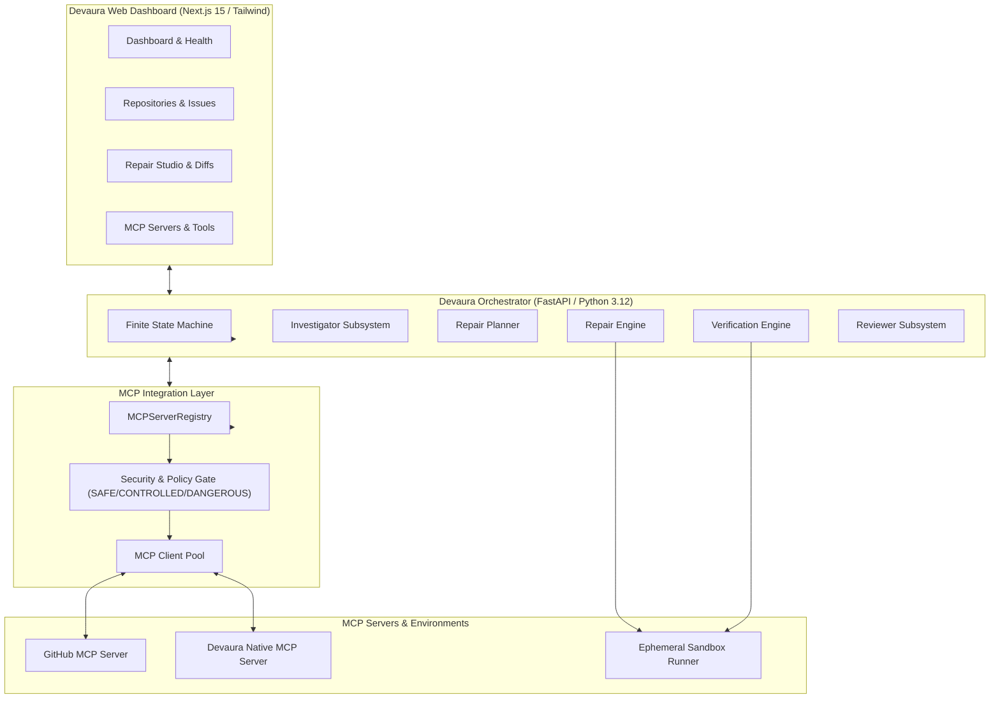

# Devaura — AI Software Repair & Maintenance Platform

> **Devaura — From failure to verified fix.**

[](LICENSE)
[](https://www.python.org/)
[](https://fastapi.tiangolo.com/)
[](https://nextjs.org/)
[](https://modelcontextprotocol.io/)

---

## 1. What is Devaura?

**Devaura** is an **MCP-native AI software maintenance and repair agent**. Rather than functioning as a conversational chatbot or a simple prompt wrapper, Devaura connects natively to code repositories, CI/CD systems, and issue trackers via the open **Model Context Protocol (MCP)** standard.

When an issue, test failure, or bug is reported, Devaura executes a rigorous automated lifecycle:

```text
Software Failure
      ↓
Context Collection (Issues, PRs, CI logs, Git history via MCP)
      ↓
Root Cause Analysis (AST, Code Search, Evidence-backed)
      ↓
Structured Repair Plan
      ↓
Human Approval Gate (Plan Sign-off)
      ↓
Patch Generation (Minimal unified diff)
      ↓
Isolated Execution (Ephemeral Sandbox)
      ↓
Testing & Verification (Pytest/Jest, Linter, Typecheck)
      ↓
Failure Analysis & Iteration (Max 3 repair loops)
      ↓
Independent Review
      ↓
Human Approval Gate (PR Sign-off)
      ↓
Pull Request Creation
```

---

## 2. Core Problem & Solution

### The Problem
Traditional AI coding assistants are reactive and unverified:
- They require developers to manually hunt down context, copy-paste stack traces, and guess affected files.
- They propose unchecked code changes directly to developers without running regression tests.
- They lack architectural awareness and make hallucinated claims without traceable evidence.
- They operate with unrestricted shell access or opaque single-vendor lock-in.

### The Devaura Solution
Devaura treats software maintenance as a closed-loop engineering process:
- **MCP-Native Host & Client**: Integrates seamlessly with GitHub MCP, native file and AST tools, and external MCP servers.
- **Evidence-Backed Root Cause Analysis**: Identifies exact failure locations with commit history, AST symbols, and test references.
- **Deterministic Sandboxing**: Executes patches and test suites inside isolated environments with memory/CPU bounds.
- **Strict Verification Protocol**: Verifies test pass rates, linting, and type checking, reporting structured status before touching Git remotes.
- **Human In The Loop**: Zero dangerous actions (pushing commits, opening PRs) can execute without explicit developer authorization.

---

## 3. High-Level Architecture



---

## 4. MCP Architecture & Native Server

Devaura complies with the official **Model Context Protocol** specification:

### Native Server Capabilities:
- `analyze_repository`: Analyzes languages, frameworks, package managers, and test runners.
- `search_code`: Multi-tier search combining exact substring, keyword ripgrep, and AST token lookups.
- `read_file`: Line-windowed file reading with path-traversal guards.
- `git_history`: Traces blame, commit diffs, and historical file modifications.
- `inspect_diff`: Computes unified diffs and changes between base and repair workspaces.
- `find_related_tests`: Heuristically maps source files to unit and integration test fixtures.
- `run_tests`: Executes sandbox test commands with exit code and stdout/stderr capture.
- `run_linter`: Runs ruff, flake8, or eslint with normalized diagnostic output.
- `run_typecheck`: Runs mypy or tsc.

---

## 5. Security Model

All operations are governed by a three-tier risk classification:
- **`SAFE`**: Read-only tools (`read_file`, `search_code`, `git_history`). Always allowed.
- **`CONTROLLED`**: Sandboxed mutations (`apply_patch`, `run_tests`, `create_branch`). Monitored and constrained.
- **`DANGEROUS`**: Upstream mutations (`push_branch`, `create_pull_request`). Strictly blocked until explicit human approval.

---

## 6. Repository Structure

```text
devaura/
├── apps/
│   ├── api/                   # FastAPI Backend
│   │   ├── main.py
│   │   ├── config.py
│   │   ├── routes/
│   │   └── requirements.txt
│   └── web/                   # Next.js 15 Web Application
│       ├── src/
│       ├── package.json
│       └── tailwind.config.ts
├── agent/                     # Core Agent Orchestration & State Machine
│   ├── orchestrator/
│   ├── investigator/
│   ├── planner/
│   ├── repair/
│   ├── verifier/
│   └── reviewer/
├── mcp/                       # Model Context Protocol Implementation
│   ├── client/
│   ├── registry/
│   ├── policy/
│   └── server/
├── integrations/              # GitHub & External Providers
│   └── github/
├── code_intelligence/         # AST Parsing, Code Search & Git Analysis
├── sandbox/                   # Isolated Execution & Verification Runners
├── database/                  # SQLAlchemy Relational Models & Storage
├── evaluation/                # Benchmarking Engine & Datasets
├── tests/                     # Unit, Integration & E2E Suites
├── docs/                      # Technical Documentation
├── docker-compose.yml
├── .env.example
└── README.md
```

---

## 7. Getting Started

### Local Setup (Quickstart)

```bash
# 1. Clone repository
git clone https://github.com/shreyvirmani/Devaura.git
cd Devaura

# 2. Setup Python environment
python -m venv .venv
# On Windows: .\.venv\Scripts\activate
# On Linux/macOS: source .venv/bin/activate

# 3. Install API dependencies
pip install -r apps/api/requirements.txt

# 4. Copy environment variables
cp .env.example .env

# 5. Run API
python -m uvicorn apps.api.main:app --reload --port 8000

# 6. In a new terminal, run Next.js web application
cd apps/web
npm install
npm run dev
```

Visit the dashboard at [http://localhost:3000](http://localhost:3000) and the API docs at [http://localhost:8000/docs](http://localhost:8000/docs).

---

## 8. Verification & Testing

```bash
pytest -v # 128 passed, 1 skipped, 0 failed (100% pass rate)
```

---

## 9. Roadmap

- [x] **Phase 1 — Foundation**: Core foundation, relational database models, MCP client/registry abstractions, FastAPI endpoints, Next.js web application skeleton.
- [x] **Phase 2 — MCP Layer**: MCP client using official MCP 2.x SDK, Devaura Native MCP Server (9 tools), MCP Server Registry, Tool Policy Engine (SAFE/CONTROLLED/DANGEROUS, path & command guards, human approval gate), deterministic Mock MCP Server, 29/29 tests passing.
- [x] **Phase 3 — Code Intelligence**: Deterministic AST parsing (Python `ast`, JS/TS), multi-tier code search (Tier 1 Ripgrep, Tier 2 Symbol, Tier 3 Path, Tier 4 Semantic abstraction), repository dependency & knowledge graph (`CONTAINS`, `DEFINES`, `IMPORTS`, `CALLS`, `EXTENDS`, `TESTS`), Git-aware intelligence (blame, change co-occurrence), test-to-source mapping, 6 new MCP tools, and interactive Web Explorer. 45/45 tests passing.
- [x] **Phase 3.5 — Code Intelligence Validation & Hardening**: Dedicated deterministic multi-language fixture repository (`tests/fixtures/validation_repo/`), scoped symbol call resolution eliminating false-positive collisions, full edge provenance metadata (`evidence`, `source_location`, `confidence`, `resolution_status`), test mapping confidence calibration, bounded blast radius traversal, incremental indexing deletion handling and hash-based index staleness detection (`READY` -> `STALE`), sensitive file exclusions (`.env*`, `*.key`), and ground-truth benchmark suite (100% precision across symbols, imports, inheritance, tests, and search). 50/50 tests passing.
- [x] **Phase 4 — Investigator**: Evidence-driven root cause localization, deterministic stack-trace & test failure parsers, change locality ranker, bounded 5-step loop, multi-candidate synthesis, evidence sufficiency evaluator (`SUFFICIENT`, `PARTIALLY_SUFFICIENT`, `INSUFFICIENT`), 6 REST APIs, and interactive Web UI. 60/60 tests passing (100% localization accuracy on benchmark).
- [x] **Phase 5 — Repair Planning & Patch Generation**: Evidence-backed repair context contracts, bounded repair planner, scoped unified diff patch generator, 5-dimension static risk analyzer (structural, behavioral, test coverage, evidence scope, security), cryptographic human approval gate (SHA-256 bound), isolated sandbox workspace runner (`.devaura_sandboxes/{id}`), 8 new Native MCP tools, 11 REST endpoints, and interactive Next.js Repair Studio. 76/76 tests passing (100% provenance, 100% scope adherence, 100% hash integrity, 100% risk recall).
- [x] **Phase 6 — Verification & Bounded Repair Loop**: Isolated sandbox verification runner (tests, lint, typecheck), structured output normalizer, deterministic SHA-256 failure signature, failure analyzer (code vs infra vs security vs timeout), bounded retry loop (strict <=3 attempts), fresh human approval gate re-arming per retry, 5 new Native MCP tools, 5 REST endpoints, interactive Next.js Verification Studio, 98/98 tests passing (100% verified repair rate on valid candidates, 100% classification accuracy, 100% retry limit enforcement, 0 original repo mutations).
- [x] **Phase 7 — Pull Request Orchestration & Human Review**: GitProvider abstraction (GitHub API client + deterministic MockGitProvider), dedicated repair branch isolation (`devaura/repair/{repair_id[:8]}`), base branch push protection, zero post-verification mutation guarantee, independent cryptographic HMAC-SHA256 human review gate (prohibits agent self-approval), base revision drift detection, structured PR metadata & markdown synthesis, 10 new Native MCP tools (total 37 tools), 9 REST endpoints, interactive Next.js PR Studio card, 128/128 tests passing (100%).
- [ ] **Phase 8 — Evaluation & Benchmarks**: Benchmark dataset runner and accuracy metrics.
