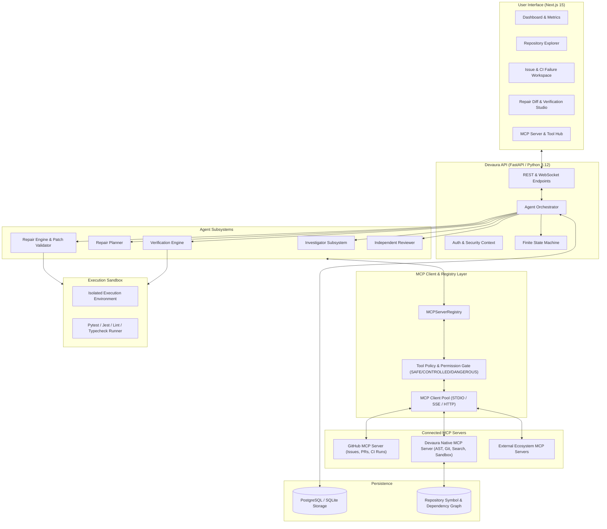
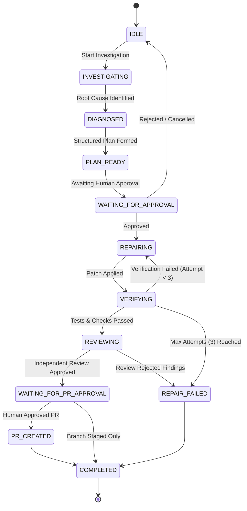

# Devaura System Architecture

## 1. Overview & Vision

Devaura is an **MCP-native AI software maintenance and repair platform**. Its objective is to transform detected failures (CI/CD test errors, GitHub issues, runtime exceptions, linter violations) into verified, reproducible code fixes that undergo automated testing, linting, typechecking, and an independent review pass before requesting human approval to open a pull request.

The core operational paradigm is:
```
Detect -> Understand -> Plan -> Repair -> Verify -> Review -> Explain
```

## 2. High-Level Architecture Diagram



## 3. Finite State Machine (Agent Lifecycle)

The agent does not operate in an unconstrained loop. State transitions are strictly enforced:



## 4. Subsystem Responsibilities

### 4.1 Orchestrator
- Coordinates state transitions across the life cycle.
- Maintains the execution context, tokens consumed, tool execution traces, and audit logs.
- Dispatches execution tasks to specialized subsystems.

### 4.2 Investigator
- Ingests issue descriptions, stack traces, comments, commit history, and CI logs via MCP.
- Performs multi-tier code searches (ripgrep, exact AST token matching, symbol lookups).
- Produces an evidence-backed diagnosis detailing `root_cause`, `confidence`, `affected_files`, `affected_symbols`, and `risk`.

### 4.3 Repair Planner
- Formulates a minimal, non-destructive repair specification.
- Details atomic changes per file, rationale, and preventative regression tests.
- Halts execution at the Human Approval Gate before touching code.

### 4.4 Repair Engine & Patch Application
- Generates targeted unified diffs.
- Syntactically parses and validates patches before application.
- Executes modifications exclusively within an isolated sandbox.

### 4.5 Verifier
- Executes unit tests, integration tests, linter checks, and typechecks.
- Normalizes disparate test tool outputs into standard structured reports (`passed`, `failed`, `skipped`, `duration`).
- Feeds failures back into the Repair Engine for up to 3 iterative attempts.

### 4.6 Reviewer
- An independent validation pass ensuring that patches address the root cause without regressions, security flaws, or style violations.
