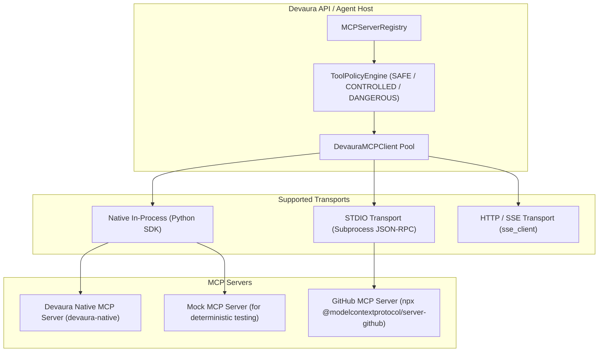

# Devaura Model Context Protocol (MCP) Architecture & Implementation

## 1. Overview & Architecture

Devaura functions as an **MCP Host**, an **MCP Client**, and exposes a dedicated **Devaura Native MCP Server** built upon the official Model Context Protocol (MCP 2.x) Python SDK.

---

## 2. Core Components

### 2.1 MCP Client Layer (`mcp/client/mcp_client.py`)
- **`DevauraMCPClient`**:
  - Connects using `ClientSession` from `mcp.client.session` with `stdio_client` and `sse_client` stream contexts or direct native server invocation.
  - Lifecycle: `connect()`, `disconnect()`, `is_connected`.
  - Capability discovery: `list_tools()`, `list_resources()`, `list_prompts()`.
  - Invocations: `call_tool(tool_name, arguments)`, `read_resource(uri)`, `get_prompt(name, arguments)`.
  - Enforces connection timeouts (default: 15s) and tool execution timeouts (default: 60s).
  - Normalizes results into `ToolCallResult` with execution latency tracking.

### 2.2 Devaura Native MCP Server (`mcp/server/devaura_server.py`)
- Official `MCPServer("devaura-native")` implementing real deterministic tools:
  1. `read_file`: Line-windowed file reading with path traversal validation.
  2. `search_code`: Multi-tier search (ripgrep with Python regex/substring fallback).
  3. `git_history`: Programmatic git log and history without shell injection.
  4. `inspect_diff`: Computes workspace git diff with automated secret sanitization.
  5. `analyze_repository`: Deterministic analysis of languages, package managers, and test runners.
  6. `find_related_tests`: Heuristic mapping from target source files to test files.
  7. `run_tests`: Command policy-checked test suite runner with exit code and stdout/stderr capture.
  8. `run_linter`: Command policy-checked linter runner.
  9. `run_typecheck`: Command policy-checked typecheck runner.
- Standardized Prompts:
  - `debug_issue`: Guides failure diagnosis given an issue description and stack trace.
  - `fix_ci_failure`: Synthesizes CI log errors and failure traces.
  - `review_pull_request`: Performs independent review of a generated code diff.

### 2.3 Tool Policy & Permission Engine (`mcp/policy/policy_engine.py`)
- **Risk Classifications**:
  - `SAFE`: Read-only, non-destructive tools (`read_file`, `search_code`, `git_history`, `inspect_diff`, `analyze_repository`, `find_related_tests`). Allowed automatically.
  - `CONTROLLED`: Sandboxed operations (`run_tests`, `run_linter`, `run_typecheck`). Checked against command execution allowlists.
  - `DANGEROUS`: Upstream mutations (`push_branch`, `create_pull_request`). Gated behind mandatory human approval.
- **Server Trust Levels**:
  - `TRUSTED`: Can execute SAFE and CONTROLLED tools. Can request DANGEROUS tools with approval.
  - `UNTRUSTED`: Can only execute SAFE read-only tools.
  - `DISABLED`: Entire server blocked (`DENY`).
- **Path Traversal Protection**: Rejects `../`, root escapes, and null-byte injection.
- **Command Policy Allowlist**: Permits only safe executables (`pytest`, `python`, `ruff`, `mypy`, `npm`, `git`), rejecting arbitrary shell commands (`curl`, `rm -rf`, `;`, `|`, `>`).
- **Human Approval Store**: Generates one-time cryptographic approval tokens that must be approved via the API before dangerous operations can run. Replay attacks are prevented by one-time token consumption.

### 2.4 MCP Server Registry (`mcp/registry/registry.py`)
- Manages connection lifecycles, runtime client pooling, capability caching, and database synchronization.
- Dispatches tool calls through the `ToolPolicyEngine` and immutably records execution traces in the database `tool_executions` audit table.

---

## 3. Testing & Verification

- **Unit Tests**:
  - `tests/test_mcp_client.py`: Client connection, capability discovery, and execution.
  - `tests/test_policy_engine.py`: Safe, controlled, and dangerous policy evaluations; path and command guards.
  - `tests/test_native_server.py`: Complete test coverage of all 9 native tools.
- **Integration & End-to-End Tests**:
  - `tests/test_mcp_e2e.py`: Complete deterministic E2E workflow: register mock server -> connect -> discover tools -> execute safe tool -> audit trace verified -> execute dangerous tool blocked by policy -> human approval granted -> execute dangerous tool -> replay attack blocked.
- **Test Results**: 29/29 tests passing (100% pass rate).
